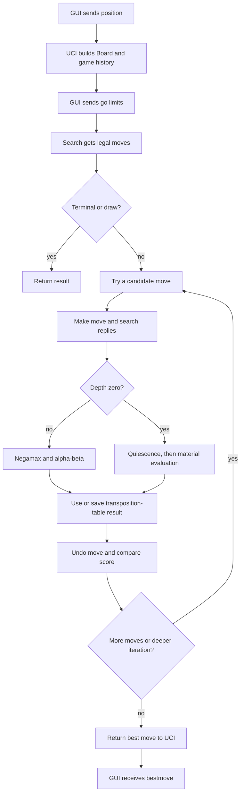

# How Cerebrum works

This page follows one engine turn from startup to the move sent back to a GUI.
The short version is: the interface supplies a position, search tries legal
moves, evaluation scores the resulting positions, and search returns its best
move.

## Main pieces and how they work together

| Part | Responsibility | Used by |
| --- | --- | --- |
| `Board` (`board.h`, `board.cpp`) | Stores pieces and the rest of the current position; makes and undoes moves. | Move generation, search, evaluation, UCI |
| FEN (`fen.cpp`) | Loads a position from a FEN string. | UCI position setup |
| Move generation (`movegen.cpp`) | Lists legal moves and checks special chess rules. | UCI input, search, console game |
| Search (`search.cpp`) | Looks ahead and chooses a move. | UCI and console game |
| Evaluation (`eval.cpp`) | Scores a position by material, from the current player's point of view. | Search at leaf positions |
| Hash/table (`tt.cpp`) | Identifies positions and reuses earlier search results. | Search and repetition tracking |
| UCI (`uci.cpp`) | Reads GUI commands and returns engine responses. | Chess GUIs and Lichess bridge |
| `main.cpp` | Starts UCI by default, or a simple terminal game with `--console`. | Program startup |

## What happens first

1. `main()` starts the UCI loop unless the program was launched with
   `--console`.
2. `runUci()` creates the starting chess position and records its hash in game
   history. A GUI can ask the engine's name/readiness, start a new game, set a
   position, or request a move.
3. On a `position` command, UCI builds a fresh board from the start position or
   from FEN. It applies the listed moves one at a time and records each
   resulting position hash. The FEN loader uses `Board::putPiece()` to place
   pieces consistently.
4. On a `go` command, UCI reads the depth or clock limits and calls
   `findBestMove()` with the current board and game history.

## How search chooses a move

1. Search gets the legal moves for the current position. If there are none, it
   returns checkmate or stalemate. It also handles repetition, the fifty-move
   condition, and supported insufficient-material draws.
2. Search begins at depth 1, then searches deeper one level at a time until it
   reaches the requested depth or time limit. This is iterative deepening; it
   keeps the best move from the last depth it completed.
3. For each candidate move, search calls `Board::makeMove()` and then searches
   the opponent's replies. When that branch is done it calls
   `Board::unmakeMove()` so the next candidate starts from the same position.
4. Search uses negamax: a score that is good for the opponent is bad for the
   current player, so each recursive result is negated. Alpha-beta pruning
   stops exploring a branch once it cannot change the choice already found.
5. Captures and promotions are searched first to help pruning. When normal
   search reaches depth zero, quiescence search continues through forcing
   captures (or all legal evasions if the side is in check) before evaluation.
6. At a quiet leaf, `evaluateMaterial()` counts the pieces. A positive score
   favors the side to move; a negative score favors the other side. Search
   compares these scores while moving back up the search tree.
7. Before calculating a position again, search probes the transposition table
   using its hash. A usable stored result can save work; completed searches
   store their score, depth, bound, and best move for later reuse.
8. Search returns its best move, score, node count, table-hit count, and last
   completed depth to UCI. UCI prints the `info` and `bestmove` responses for
   the GUI.

## Decision flow

## One important current limitation

The search runs synchronously. It stops when its own time limit expires, but
the current `stop` command cannot interrupt a search while it is running.
Also, evaluation currently considers material only, so search can calculate
many lines without understanding positional concepts such as king safety or
piece activity. See [search.md](search.md), [eval.md](eval.md), and [uci.md](uci.md)
for details.
